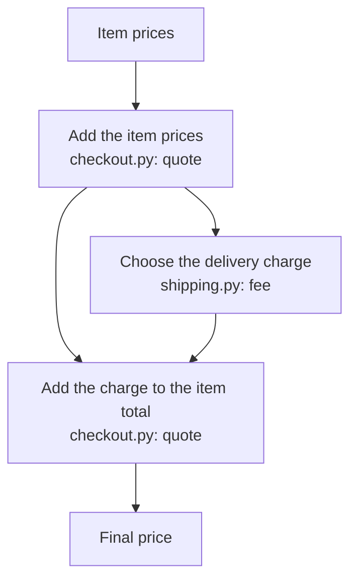

# An illustrative beginner lesson

This entire example, including every learner response, is invented. It shows the intended teaching experience; it is not a real learner test or an execution transcript. A real lesson uses the learner's project and pauses for their actual responses.

The complete fictional code is at the end of this page. Source pointers refer to line numbers within those two code blocks, both from the same illustrative version.

## Begin with what the person wanted to build

**Learner:** I asked AI to make a shop checkout that includes delivery in the price. I don't write code. Please start slowly.

**Agent:** Let's follow one basket together. This small example adds the item prices, works out the delivery charge, then combines them into the final price. We'll stay with that calculation first. (`checkout.py:L3-L6`)

Imagine a cashier adding up a basket and checking a delivery price card. The card says delivery costs 5, unless the items cost at least 50. The code uses that same rule. (`shipping.py:L1-L5`)

The cashier is only a comparison: these files calculate numbers. They do not collect a payment or arrange a real delivery. (`checkout.py:L1-L6`; `shipping.py:L1-L5`)

*If the learner had asked to agree the scope first, the agent would propose this one-basket lesson and wait before inspecting the project. Here, the learner asked to begin.*

## Show the small picture

**Agent:** There are two files involved. A file is a named document containing some of the project's instructions. `checkout.py` coordinates the price calculation. `shipping.py` holds the delivery rule. Here is the path through them:



The arrows come from the code below. The item total is used twice: to choose the delivery charge and to calculate the final price. The map was drawn from those instructions; no external diagram service is involved. (`checkout.py:L3-L6`; `shipping.py:L4-L5`)

## Walk through one basket

**Agent:** Suppose the basket has two items, priced 20 and 25. This is an example we chose for the lesson. First we add them: `20 + 25 = 45`. The code calls that number the **subtotal**: the cost of the items before delivery is added. (`checkout.py:L3-L4`)

You will also see the name `quote`. It names a **function**, a small set of instructions that does a particular job. This one receives the prices and calculates the final amount. The prices it receives are its **input**. We don't need to learn every symbol yet; first we'll follow the job it does. (`checkout.py:L3-L6`)

Next, `quote` asks another function, called `fee`, to choose the delivery charge. It passes along the subtotal, 45. `fee` lives in `shipping.py`, so this is the connection between the two files. (`checkout.py:L1-L5`; `shipping.py:L4-L5`)

Our subtotal is below 50, so `fee` sends back 5. The code word for sending an answer back is **return**. `quote` then adds that charge to the subtotal: `45 + 5 = 50`, the final price. (`shipping.py:L1-L5`; `checkout.py:L5-L6`)

We worked this out by reading the instructions, without running them. This is a **static walkthrough**. The calculation shows what this example's code predicts; it is not an observed run.

## Invite a guess

**Agent:** Want to try one small variation? If the items total exactly 50, what do you think the delivery charge will be? You can make a guess, ask for a hint, or have me walk through it.

*A real interactive session pauses here. The following exchange is one invented continuation.*

**Learner:** I think it stays 5. Don't you have to go over 50?

**Agent:** We need to look closely at the word "at least" in the rule. In the code, `>=` means "greater than or equal to." So exactly 50 qualifies for free delivery too. That includes the equality case we hadn't looked at together yet. (`shipping.py:L5`)

**Learner:** So the delivery charge is 0, and the final price stays 50?

**Agent:** Yes. You kept the two amounts separate and then added them correctly. If you're comfortable, try one more thought: what would happen at exactly 50 if the rule used `>`—"greater than"—instead? (`checkout.py:L5-L6`; `shipping.py:L5`)

*The agent would pause again.*

**Learner:** Then exactly 50 wouldn't qualify. Delivery would cost 5, making the final price 55.

**Agent:** That explains this rule and predicts the effect of the change. We can mark this particular idea as demonstrated in this example. We haven't checked your understanding of the rest of a real shop project.

## Move into reading the code

**Learner:** I can follow the numbers now. Where would I look to change the delivery rule?

**Agent:** Start in `shipping.py`. The first two lines name the cutoff and the usual charge, and line 5 chooses which charge to use. These names are **variables**: labels the code uses to refer to values. Here, `FREE_FROM` refers to 50 and `STANDARD_FEE` refers to 5. (`shipping.py:L1-L5`)

Keeping the delivery rule in its own file could make it easier to change in one place. That's my interpretation of this structure; the example has no written record of why its author chose it. (`checkout.py:L1-L5`; `shipping.py:L1-L5`)

Here is a short reading route for the connections we just followed:

| Read | Notice | Question it answers |
| --- | --- | --- |
| `checkout.py`, lines 3–4 | `quote` receives the prices and adds them. | Where does the item total come from? |
| `shipping.py`, lines 1–5 | `fee` chooses either 0 or 5. | What determines the delivery charge? |
| `checkout.py`, lines 5–6 | The delivery charge is added to the item total. | How does the other file's answer affect the final price? |

The code below does not explicitly check whether the supplied prices are sensible. Such checks are called **input validation**. How a larger app would handle invalid prices is outside this example. (`checkout.py:L3-L6`; `shipping.py:L4-L5`)

## Save only if requested

**Learner:** Save my progress outside the project, in my learning-notes folder.

The agent uses the requested location once it is known. A record for this invented exchange could contain:

| Concept | State | Evidence | Next step |
| --- | --- | --- | --- |
| Delivery cutoff and comparison | Demonstrated | Learner explained the exactly-50 case and predicted the effect of `>`. | Revisit if the rule changes. |
| Connection between the two files | Explained | Agent traced it; learner has not explained the connection back. | Invite a walkthrough of another basket. |
| Checking supplied prices | Not assessed | No exercise answered on this topic. | Inspect checks in the actual project. |

In a real session, only the learner's actual responses support those entries. Without a save request, the session stays in chat. Saved findings also identify the inspected project version and actual source locations.

## The complete example code

`shipping.py`:

```python
FREE_FROM = 50
STANDARD_FEE = 5

def fee(subtotal):
    return 0 if subtotal >= FREE_FROM else STANDARD_FEE
```

`checkout.py`:

```python
from shipping import fee

def quote(prices):
    subtotal = sum(prices)
    shipping = fee(subtotal)
    return subtotal + shipping
```
